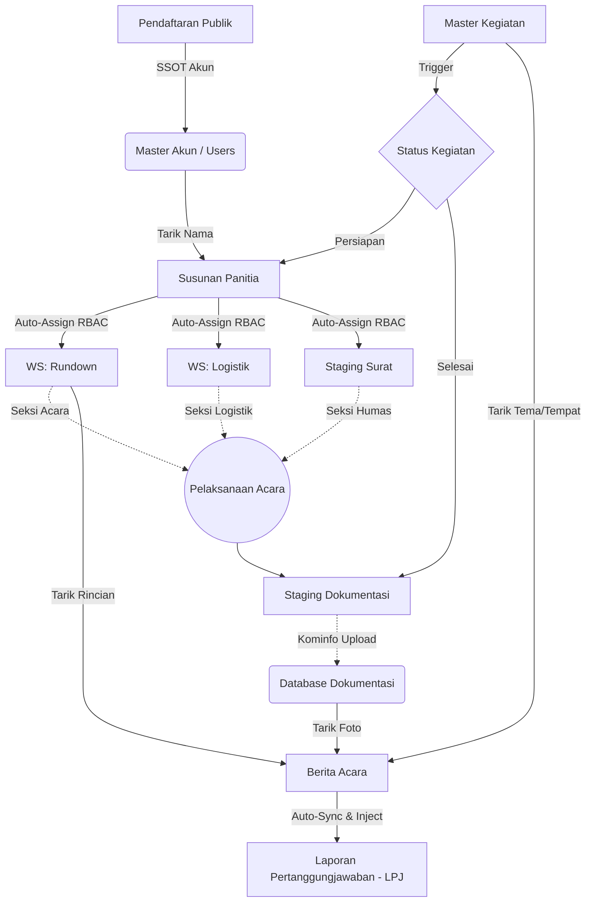

# 🛠️ Panduan Developer BEM (Developer Guide)
*Dokumen Onboarding & Analisis Keterhubungan Sistem*

Selamat datang di *codebase* Sistem Manajemen BEM! Sistem ini dibangun dengan fokus pada efisiensi, keamanan, dan otomatisasi tingkat tinggi. Sebagai *developer* baru, Anda **wajib** memahami filosofi arsitektur di bawah ini sebelum melakukan perubahan pada basis kode.

---

## 1. Filosofi Arsitektur Utama

Sistem ini menganut tiga pilar utama:
1. **Single Source of Truth (SSOT):** Data dasar (seperti Nama Anggota, Jabatan, dan Master Kegiatan) hanya diinput **satu kali** di modul intinya. Modul lain *wajib* menarik data menggunakan Foreign Key (ID), bukan mengetik ulang teks *hardcoded*.
2. **Event-Driven Workflow:** Pekerjaan satu divisi memicu tugas untuk divisi lain. (Misal: Kegiatan berstatus *Selesai* otomatis membuka form *Upload* Dokumentasi untuk tim Kominfo).
3. **Smart RBAC (Role-Based Access Control):** Hak akses tidak bersifat global. Akses "Workspace" (seperti Logistik, Acara, Surat) diberikan secara dinamis berdasarkan posisi anggota di tabel `kegiatan_panitia` pada masing-masing kegiatan.

---

## 2. Peta Keterhubungan Sistem (Workflow Map)

Perhatikan diagram berikut untuk memahami bagaimana data mengalir dari tahap Pendaftaran hingga Laporan Akhir (LPJ):

---

## 3. Komponen Krusial & Aturan Modifikasi

### A. Manajemen Akses (RBAC & Sidebar)
* **File Utama:** `admin/core/header.php` dan `includes/functions.php`.
* **Aturan:** JANGAN menggunakan pengecekan `if ($admin_role == 'logistik')` untuk fitur spesifik kegiatan. Gunakan pengecekan *Workspace* berdasarkan tabel `kegiatan_panitia` (contoh: `$ws['event_role'] === 'sie_logistik'`).
* **Pengecualian:** Divisi Kominfo memiliki menu `Staging Dokumentasi` yang hanya muncul secara eksklusif bagi mereka saat ada kegiatan yang berstatus *Selesai*.

### B. Pembuatan Panitia (`buat-panitia.php`)
* Modul ini bukan sekadar membuat PDF SK Panitia, melainkan **otak pembagian akses**.
* Setiap kali panitia disimpan, sistem akan melakukan *auto-sync* ke tabel `kegiatan_panitia`. Inilah yang memicu terbukanya akses *Workspace* bagi akun terkait.

### C. Modul Berita Acara & LPJ
* Modul ini adalah **titik kumpul** (Agregator) dari seluruh pekerjaan.
* **Berita Acara (`buat-berita-acara.php`)** secara otomatis menarik:
  1. *Rundown* dari Sie Acara.
  2. *Dokumentasi JSON* dari Kominfo (`arsip_dokumentasi`).
* **LPJ** menggunakan fitur *Two-Way Sync*. Jika ada perubahan data pada Berita Acara, JSON pada dokumen LPJ akan ter-*update* secara otomatis. Jangan merusak struktur array JSON-nya.

### D. Manajemen File / Gambar
* **File Utama:** `includes/functions.php` -> fungsi `uploadFile()`.
* **Aturan:** JANGAN menggunakan `move_uploaded_file()` secara manual. Selalu gunakan fungsi `uploadFile()` yang sudah terintegrasi dengan Object Storage (S3) dan pengamanan tipe file (Otomatis konversi ke WebP). Untuk merender gambar di *frontend*, gunakan fungsi `uploadUrl($nama_file)`.

---

## 4. "What NOT To Do" (Pantangan Developer)
1. ❌ **Membuat Input Teks Bebas untuk Nama Pengguna.** Selalu gunakan elemen `<select>` yang ditarik dari *database* (`users`).
2. ❌ **Meminta File/Data yang Sama Dua Kali.** Jika data sudah pernah diinput divisi lain (contoh: *Rundown*), buatlah API *fetcher* (`api-get-kegiatan-data.php`) untuk menariknya secara otomatis, jangan menyuruh *user* mengunggah/mengetik ulang.
3. ❌ **Mengabaikan Sinkronisasi LPJ.** Modul-modul di BEM (BEM & BPM) dirancang untuk berujung pada kemudahan pembuatan LPJ. Jika Anda membuat fitur operasional baru, pikirkan *"Bagaimana data ini bisa otomatis masuk ke laporan akhir?"*.

---
*Dokumen ini dibuat dan dijaga untuk kelancaran regenerasi tim IT BEM. "Code with logic, design with empathy."*

---

## 5. Perubahan Alur Administrasi & Tanda Tangan (31 Oktober 2026)

### Relasi kegiatan pada surat, rundown, dan logistik

- Form surat dan berita acara mengirim `kegiatan_id` saat mengambil data rundown, logistik, atau dokumentasi. API mengutamakan ID kegiatan; pencarian berdasarkan nama hanya menjadi fallback untuk arsip yang belum memiliki relasi, dan tidak digunakan bila nama kegiatan ambigu.
- Data lampiran logistik baru menyimpan `lampiran_pinjam.kegiatan_id`. Data lama hanya dihubungkan otomatis bila nama kegiatan cocok secara unik pada periode yang sama.
- Redirect tindakan staging surat mempertahankan filter kegiatan yang sedang dipilih.
- Sebelum menerapkan kode pada database lama, jalankan migrasi sesuai engine setelah membuat backup:
  - MySQL/MariaDB: `database/migrations/2026-10-31-link-logistics-to-activities.mysql.sql`
  - PostgreSQL: `database/migrations/2026-10-31-link-logistics-to-activities.pgsql.sql`

### Berita Acara

- Saat master kegiatan dipilih, form BA mengisi kode, tanggal dan durasi, waktu, serta tempat dari data kegiatan. Nilai tetap dapat diedit sebelum disimpan.
- Nama Sekretaris Umum pada BA baru diambil dari anggota pengurus yang valid jika pengaturan tanda tangan kosong atau berisi label jabatan generik. Nama BA yang sudah tersimpan tetap merupakan snapshot dokumen dan tidak diubah otomatis.
- Pada cetakan BA, blok tanda tangan dipindah ke halaman baru bila rincian kegiatan lebih dari tiga. URL kop surat memakai cache-buster agar perubahan gambar dapat terlihat tanpa cache lama.

### Integrasi Program Kerja kementerian dan kegiatan

- `program_kerja` adalah sumber daftar aktif per kementerian dan periode. `kegiatan.kementerian_id` serta `kegiatan.program_kerja_id` menyimpan relasi berbasis ID; `kegiatan.pelaksana` dan `kegiatan.program_kerja` tetap disimpan sebagai snapshot teks agar data lama dan dokumen yang sudah memakai kolom tersebut tidak berubah.
- Menghapus item dari daftar kementerian mengarsipkannya. Item arsip tidak lagi muncul sebagai rekomendasi, tetapi relasi dan teks kegiatan lama dipertahankan; item arsip dapat dipulihkan dari halaman edit kementerian.
- Nama Program Kerja yang diketik di master kegiatan tetap menjadi teks kegiatan kecuali admin mencentang **Ajukan sebagai usulan**. Usulan tidak tersedia sebagai rekomendasi aktif sampai disetujui di halaman edit kementerian. Usulan yang diarsipkan juga tidak menghapus teks/referensi kegiatan pengusul.
- Menghapus kementerian mengarsipkan seluruh Program Kerja dan melepas relasi ke kementerian, tetapi tidak menghapus record Program Kerja atau referensi kegiatan.
- Sebelum deploy kode pada database lama, backup database lalu jalankan migrasi sesuai engine:
  - MySQL/MariaDB: `database/migrations/2026-10-31-link-program-kerja.mysql.sql`
  - PostgreSQL: `database/migrations/2026-10-31-link-program-kerja.pgsql.sql`
- Migrasi MySQL/MariaDB mengimpor daftar JSON yang valid. Relasi kegiatan lama diisi hanya bila nama pelaksana dan Program Kerja cocok secara unik pada periode/kementerian yang sama; pasangan ambigu tetap sebagai snapshot teks tanpa ID. Migrasi PostgreSQL hanya menjalankan backfill bila kolom legacy yang diperlukan tersedia pada instalasi tersebut.

### Unggahan tanda tangan pendaftaran

- Pendaftar dapat mengunggah PNG/JPG dengan ukuran maksimum **5 MB**. Batas diperiksa di browser dan server; server juga memeriksa format gambar, ukuran file, dan dimensi maksimum 8000×8000 piksel.
- Berkas disimpan melalui `uploadFile()` dan database menyimpan path relatif. Ketika pendaftaran disetujui, path diteruskan ke akun, data anggota, dan daftar panitia tetap yang relevan; file dibersihkan bila insert pendaftaran gagal.
- Tabel `signatures` belum menjadi sumber utama alur ini. Jangan menganggapnya terisi oleh pendaftaran tanpa mengubah dan menguji alur penyimpanan terlebih dahulu.
- Migrasi kolom dan tabel untuk skema lama tersedia di:
  - MySQL/MariaDB: `database/migrations/2026-10-31-registration-signatures.mysql.sql`
  - PostgreSQL: `database/migrations/2026-10-31-registration-signatures.pgsql.sql`
- Konfigurasi PHP/Nginx harus mengizinkan sedikitnya 5 MB per file dan ukuran total request lebih besar dari batas tersebut. Beberapa PHP built-in/local runtime memiliki `upload_max_filesize` lebih kecil; periksa `upload_max_filesize`, `post_max_size`, dan batas web server pada environment yang diuji.

### Pemeriksaan setelah migrasi atau deployment

1. Tambah Program Kerja di edit kementerian, lalu pilih kementerian di master kegiatan dan pastikan rekomendasi menyimpan ID yang benar.
2. Ketik Program Kerja baru pada master dan ajukan sebagai usulan; pastikan tidak menjadi pilihan aktif sampai disetujui, lalu pastikan persetujuan menyinkronkan JSON kompatibilitas kementerian.
3. Arsipkan item yang telah dipakai oleh kegiatan; pastikan rekomendasi hilang, data teks/ID kegiatan tetap ada, dan item dapat dipulihkan.
4. Hapus kementerian uji yang punya Program Kerja; pastikan Program Kerja berstatus arsip dan kegiatan tetap menyimpan snapshot serta referensi riwayat.
5. Buat surat dan BA untuk dua kegiatan bernama sama; pastikan data yang ditarik berasal dari ID kegiatan yang dipilih.
6. Buat lampiran logistik baru, ubah data lampiran, lalu periksa relasi kegiatan dan filter staging setelah tindakan.
7. Uji pendaftaran dengan gambar valid, file di atas 5 MB, ekstensi/MIME tidak cocok, serta upload yang gagal; pastikan error ditampilkan dan tidak ada pendaftaran palsu yang sukses.
8. Setujui satu pendaftar uji dan periksa referensi `file_ttd` pada akun, tabel anggota yang sesuai, dan `panitia_tetap` bila jabatannya Ketua/Sekretaris.
9. Cetak BA dengan tiga rincian dan lebih dari tiga rincian; periksa pemisahan blok tanda tangan dan hasil kop surat.
